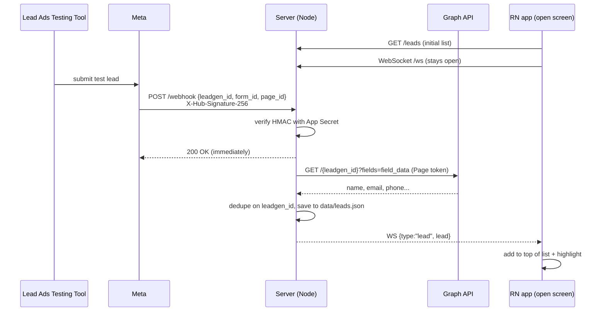

# Meta Lead Ads → React Native, live

When someone submits a **Meta Lead Ad form**, the lead shows up **live** on a React Native screen
that's already open. Nobody has to touch the phone: no pull-to-refresh, no push notification.
Submissions are simulated with Meta's
[Lead Ads Testing Tool](https://developers.facebook.com/tools/lead-ads-testing).

```
server/   Node.js + Express + ws: receives Meta webhooks and pushes leads to the app
app/      Expo (React Native, TypeScript): the single "Leads" screen
docs/     Loom video scripts
ASSUMPTIONS.md
```

## How it works



Plain-text version:

```
Testing Tool ──► Meta ──HTTPS POST /webhook──► Server ──GET /{lead-id}──► Graph API
                                                 │  (verify signature, dedupe, store)
                                                 └──WebSocket /ws──► RN app (FlatList updates)
```

The webhook only contains **IDs**. The answers to the form (name, email, phone) have to be
fetched from the Graph API with a Page access token. If that fetch fails (no token, expired token,
missing permission, or the fake id from the dashboard **Test** button), the lead is still stored and
broadcast. The app then shows it as `Lead <leadgen_id>` with a red "Details unavailable: …" line,
so it never disappears silently.

## Run it locally (no Meta account needed)

Needs Node 22.9 or newer (`npm start` uses `node --env-file-if-exists`).

```bash
# terminal 1: server
cd server
npm install
cp .env.example .env        # PowerShell: Copy-Item .env.example .env
#   set VERIFY_TOKEN and APP_SECRET to any test values, and MOCK_GRAPH=1
npm start

# terminal 2: watch the realtime channel
cd server
npm run listen

# terminal 3: send a signed, fake Meta webhook
cd server
npm run simulate                        # new lead
npm run simulate -- --id 123            # send twice: the second one is ignored as a duplicate
npm run simulate -- --bad-signature     # rejected with 403
curl "http://localhost:3000/leads"
curl "http://localhost:3000/webhook?hub.mode=subscribe&hub.verify_token=<VERIFY_TOKEN>&hub.challenge=123"
```

### The app

```bash
cd app
npm install
cp .env.example .env        # set EXPO_PUBLIC_API_URL (see below)
npx expo start              # scan the QR code with Expo Go (Android) or the Camera app (iOS)
npx expo start --web        # or run the same screen in a browser (http://localhost:8081)
```

With the server running and `MOCK_GRAPH=1`, every `npm run simulate` makes a new card appear at the
top of the open screen with a yellow highlight and a **NEW** badge. Stop the server and the pill turns
to **Reconnecting…**; start it again and it goes back to **Connected** and re-fetches `/leads`.

`EXPO_PUBLIC_API_URL` is the server's base URL. The app derives the WebSocket URL from it
(`https` becomes `wss`, `http` becomes `ws`):

| Setup | Value |
|---|---|
| Public tunnel (recommended for the demo) | `https://<random>.trycloudflare.com` |
| Same Wi-Fi as the PC | `http://<PC IPv4 from ipconfig>:3000` (allow Node through Windows Firewall on Private networks) |
| Android emulator | `http://10.0.2.2:3000` |

Expo reads `.env` when it starts. After changing it, restart with `npx expo start -c`.
If the phone can't reach Metro over Wi-Fi, use `npx expo start --tunnel`.

## Making the server public (Meta requires HTTPS)

Meta only calls **HTTPS** callback URLs with a valid certificate (self-signed certificates are
rejected). Pick one of these options:

**A. Cloudflare quick tunnel (no account needed, preferred)**
```bash
# install once (Windows): winget install --id Cloudflare.cloudflared
cloudflared tunnel --url http://localhost:3000
# prints https://<random-words>.trycloudflare.com  (this URL changes on every run)
```
WebSockets work through it (`wss://<same-host>/ws`). Keep this terminal open while recording.
Every restart gives a new URL, so you then have to update the Meta callback URL and `app/.env`.

**B. ngrok**: `ngrok http 3000` (needs a free account + authtoken). Use the `https://…ngrok-free.app` URL.

**C. Render / Railway free tier**: deploy the `server/` folder as a Node web service.
Build `npm install`, start `npm start`, and set the env vars in the dashboard. Render's free tier
sleeps when idle and has an ephemeral disk, so `data/leads.json` is wiped on redeploy. That's
fine for a demo; open the URL once before recording to wake it.

## Meta setup (step by step)

Read the gotchas at the end before you start. Most "it doesn't work" problems are on Meta's side.

You need a Facebook account, a **Facebook Page** you admin, and a server running behind an HTTPS URL
(see the previous section).

1. **Create the app.** Go to https://developers.facebook.com/apps, click **Create app**, and pick
   the use case **"Capture & manage ad leads with Marketing API"** (on the older flow: type **Business**).
   Connect a business portfolio if asked. This use case adds **Webhooks** and Facebook Login for Business.
   If you use the old flow, add the **Webhooks** product manually.
2. **Note the App Secret.** Open **App settings → Basic → App secret** and put it in `server/.env` as `APP_SECRET`.
3. **Start the server and the tunnel** (`npm start` + `cloudflared tunnel --url http://localhost:3000`).
4. **Configure the webhook.** In **Webhooks**, choose the **Page** object, then **Subscribe to this object**:
   - Callback URL: `https://<tunnel-host>/webhook`
   - Verify token: the same string as `VERIFY_TOKEN` in `server/.env`
   - Click **Verify and save**. The server logs `[webhook] verification OK`.
   - Then **subscribe to the `leadgen` field** in the list of Page fields.
   - Optional: the **Test** button next to `leadgen` sends a sample event. It shows up in the app with
     "Details unavailable", because its lead id is fake. That still proves the URL and signature work.
5. **Get a Page access token** in [Graph API Explorer](https://developers.facebook.com/tools/explorer):
   select your app, click **Get Page Access Token** (or "User or Page" → your Page), and grant:
   `pages_show_list`, `pages_read_engagement`, `pages_manage_metadata`, `leads_retrieval`,
   `ads_management` (the use case also lists `pages_manage_ads` and `business_management`, so grant them if offered).
   Pick your **Page** in the dropdown so the token is a *Page* token, not a User token.
   - If `pages_manage_metadata` isn't in Explorer's list, add it first under **Use cases → Capture &
     manage ad leads → Permissions and features → Add**. Without it, Track status says
     *"Required permissions are missing for the app"* and nothing is delivered.
   - Explorer tokens expire after about 1 hour. To get one that lasts through the demo, open the
     [Access Token Debugger](https://developers.facebook.com/tools/debug/accesstoken/) and click
     **Extend Access Token** on the *user* token, then call
     `GET /me/accounts?access_token=<long-lived user token>`. The Page tokens it returns don't expire.
   - Put the Page token in `server/.env` as `PAGE_ACCESS_TOKEN`, set `MOCK_GRAPH=0`, and restart the server.
6. **Install the app on the Page** (without this, Meta sends nothing). The shortcut is
   `cd server && npm run subscribe`, which reads `PAGE_ACCESS_TOKEN` from `.env`, subscribes, and lists the result.
   By hand:
   ```bash
   curl -X POST "https://graph.facebook.com/v25.0/<PAGE_ID>/subscribed_apps?subscribed_fields=leadgen&access_token=<PAGE_ACCESS_TOKEN>"
   # -> {"success":true}
   curl "https://graph.facebook.com/v25.0/<PAGE_ID>/subscribed_apps?access_token=<PAGE_ACCESS_TOKEN>"
   # -> should list your app with "subscribed_fields":["leadgen"]
   ```
   (Get the Page ID from `GET /me/accounts` or from the Page's About section.)
7. **Create a lead form** on the Page: Meta Business Suite → **All tools → Instant Forms**
   (or Page → Publishing tools → Forms library) → **Create form**. Ask for full name, email and
   phone, then **Publish**. You don't need an ad, because the testing tool submits against the form directly.
8. **Point the app at the tunnel.** In `app/.env` set
   `EXPO_PUBLIC_API_URL=https://<tunnel-host>` (no `/webhook`, no trailing slash), then restart Expo
   with `npx expo start -c` (the `-c` clears the cache so the new value is picked up). Open the app;
   the pill should turn green (**Connected**) and the server logs `[ws] client connected`.
   Quick check from the PC: `npm run listen -- wss://<tunnel-host>/ws`.
9. **Submit a test lead.** Open https://developers.facebook.com/tools/lead-ads-testing,
   choose the Page and the form, then click **Create lead** (or **Preview form** to type your own
   answers). Click **Track status**. Within a few seconds it should say **success**, the server logs
   `new lead … stored + broadcast`, and the lead appears in the app.

### Before every recording take

1. `cloudflared` is running. If you restarted it, the URL changed: update the callback URL in
   Webhooks → Page, and `EXPO_PUBLIC_API_URL` in `app/.env` (then `npx expo start -c`).
2. `curl https://<tunnel-host>/` returns `meta-leads-server OK`.
3. `server/.env` has the real `APP_SECRET`, `PAGE_ACCESS_TOKEN` and `MOCK_GRAPH=0`.
4. In the testing tool, **Delete lead** for the form you'll use (only one test lead per form is allowed).
5. The app is open and shows **Connected**.

### Gotchas (check these first if nothing arrives)

- **Development vs Live mode.** Meta's webhook docs say an app in development mode only receives
  notifications from people **who have a role on the app**. The Lead Ads Testing Tool docs
  also say *"you cannot use the tool in developer mode"*. If **Track status** stays *pending*/*failed*
  and nothing reaches the server, switch the app to **Live**. To do that, add an app icon,
  category and privacy policy URL under App settings → Basic, then publish. App Review is
  **not** required for webhooks, and Standard Access permissions work for users who have a role on the app.
- **The tester needs roles.** Your Facebook user must be an **admin/developer of the app** *and* have
  **Advertiser (or higher)** access on the Page.
- **Leads Access Manager.** If the Page has lead access restricted (Meta Business Suite /
  Business settings → **Integrations → Leads access**), assign **both your user and this app**
  ("CRMs" tab). Otherwise the Graph fetch fails with a permissions error, and the app shows the lead
  with "Details unavailable".
- **One test lead per form.** The testing tool only allows one lead per form. Click **Delete lead**
  before creating another (or make a second form).
- **Lead shows "Details unavailable"?** The webhook arrived but the Graph fetch failed. The red line
  shows Meta's error message. Usually the token is a User token instead of a Page token, it has
  expired, or `leads_retrieval` / Leads Access is missing.
- **Forgot step 6?** With no `subscribed_apps` call there are no webhooks, even if the dashboard
  subscription looks fine.
- **Tunnel URL changed?** Quick-tunnel URLs change on every restart. Update the callback URL
  (Webhooks → Page → Edit subscription) and `EXPO_PUBLIC_API_URL`.
- **403 in the server log** means `APP_SECRET` doesn't match the app that sends the webhooks.
- **Graph version.** The server uses `GRAPH_VERSION` (default `v25.0`; `v26.0` is also current).

## API

| Route | Purpose |
|---|---|
| `GET /` | Health check |
| `GET /webhook` | Meta verification handshake (`hub.mode`, `hub.verify_token`, `hub.challenge`) |
| `POST /webhook` | Meta `leadgen` notifications (signature-checked) |
| `GET /leads` | All leads, newest first |
| `WS /ws` | Pushes `{"type":"lead","lead":{…}}` for every new lead |
